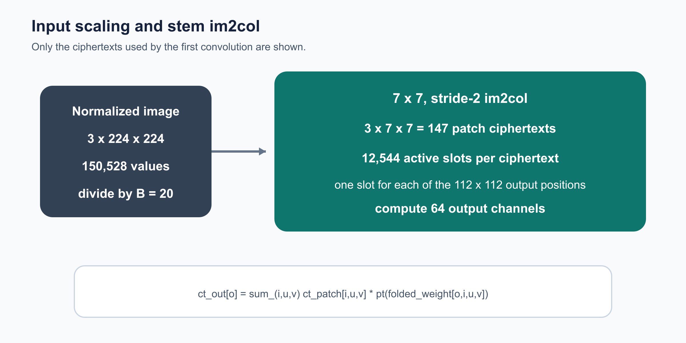
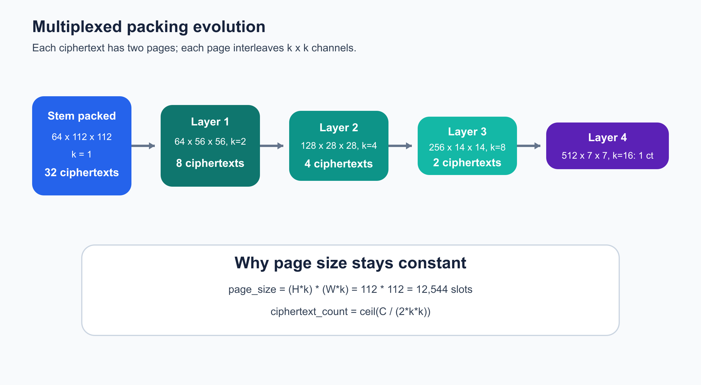
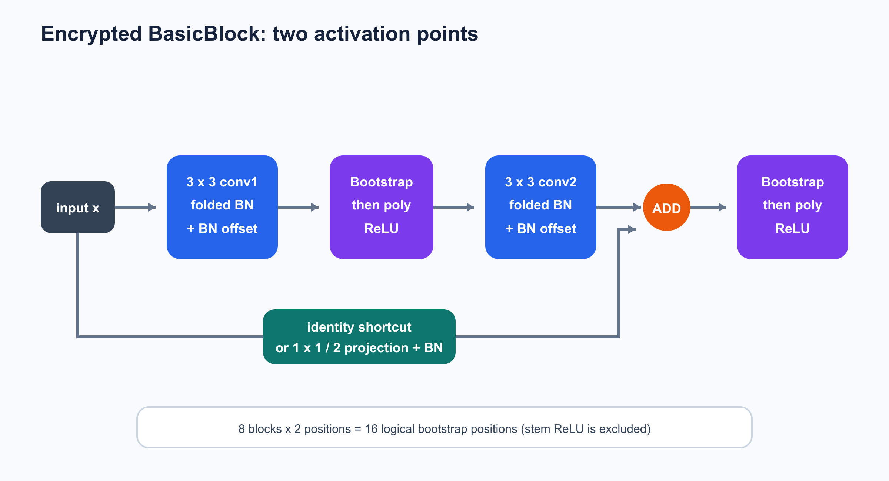
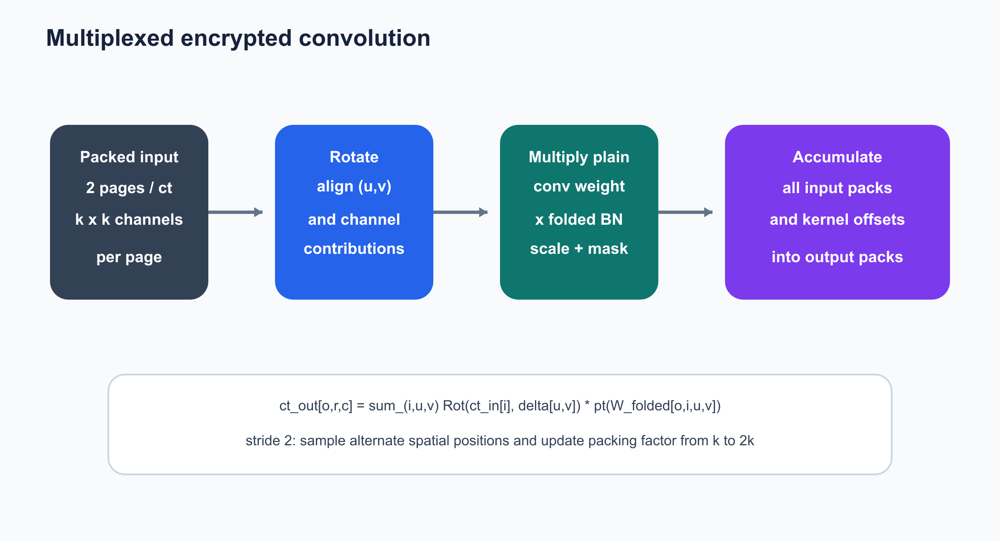
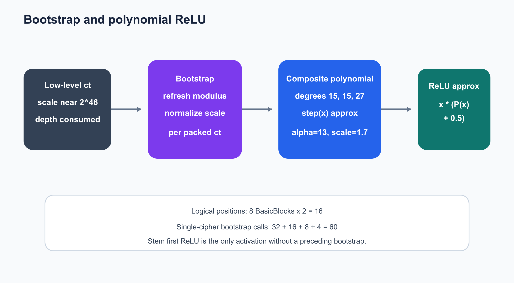
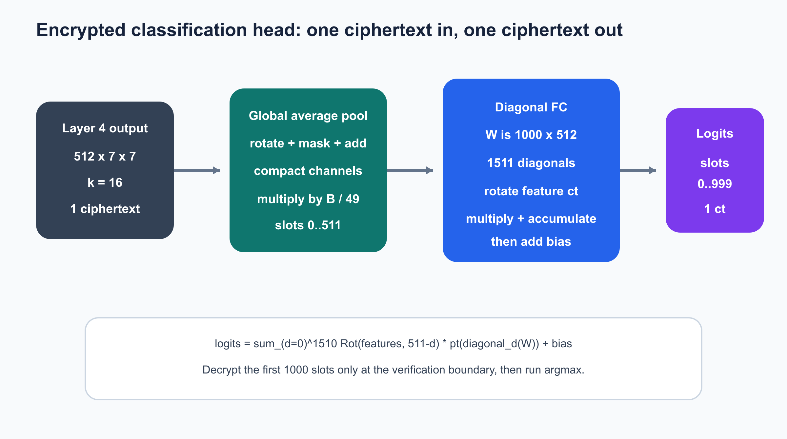

# ResNet-18 密态推理 Benchmark

### ResNet-18

本文说明 `Trident/resnet18` 如何使用 Poseidon CKKS 完成 ImageNet ResNet-18密态推理。输入是一张 `3 x 224 x 224` 图片，输出为 1000 个 ImageNet
类别 logits。

当前实现采用 BasicBlock 版 ResNet-18。标准 max-pool 需要比较操作，CKKS不能直接完成，因此 stem 使用同样尺寸的 `3 x 3`、stride-2 average-pool。
网络结构如下。


| 网络部分 | Block 数 | 输出形状 |
| --- | ---: | ---: |
| Stem：`7 x 7` 卷积 | 1 | `64 x 112 x 112` |
| Stem：`3 x 3` 平均池化 | - | `64 x 56 x 56` |
| Layer 1 | 2 | `64 x 56 x 56` |
| Layer 2 | 2 | `128 x 28 x 28` |
| Layer 3 | 2 | `256 x 14 x 14` |
| Layer 4 | 2 | `512 x 7 x 7` |
| 全局平均池化 + FC | - | 1000 logits |

一个 BasicBlock 的明文逻辑为：

```text
y = ReLU(F(x; W) + S(x))

F: 3x3 conv -> BN -> ReLU -> 3x3 conv -> BN
S: identity，或 1x1 stride-2 projection -> BN
```

模型权重作为 CKKS 明文参与运算；输入与中间激活保持为密文。当前程序还会在同一进程中持有私钥并解密中间结果，用于逐层正确性检查，所以它是研究与
验证原型，不是 evaluator-only 的生产部署。

### CKKS 与多项式 ReLU

CKKS 支持近似 SIMD 加法、乘法和 rotation，但不直接支持比较。代码用三段复合多项式近似阶跃函数，再计算 ReLU：

```text
ReLU(x) ~= x * (P3(P2(P1(x))) + 0.5)
degree(P1, P2, P3) = (15, 15, 27)
```

当前参数如下。

| 参数 | 当前值 |
| --- | ---: |
| 多项式模数次数 | `N = 2^16` |
| CKKS slots | `2^15 = 32768` |
| 默认 scale | 约 `2^40` |
| Bootstrap EvalMod scale | 约 `2^45` |
| Q 链 | `1 x 45-bit + 20 x 40-bit + 14 x 45-bit`（35 primes / 1475 bit） |
| 特殊模数 P | 默认 `12 x 51-bit` |
| dnum | 默认 `3`，可选 `4` |
| 输入/激活边界 | `B = 20` |
| 逻辑 bootstrap 位置 | 16 |
| 当前 packing 下单密文 bootstrap 调用 | 60 |

## 实现过程

密态数据流依次为：

```text
预处理与缩放
-> 输入加密与 stem im2col
-> multiplexed packing
-> 8 个密态 BasicBlock
-> 全局平均池化
-> BSGS 对角线矩阵法 FC
-> 解密 logits 与 argmax
```

### 步骤 1：输入加密与 Stem

每个 ImageNet 样本按 CHW 顺序包含：

```text
3 x 224 x 224 = 150528 values
```

输入首先除以全局边界 `B = 20`，随后直接为首层卷积构造 im2col 布局。对于 3 个输入通道和 `7 x 7` 核，一共加密 147 个 patch 密文；每个密文的 12544 个有效 slots对应 `112 x 112` 个输出空间位置。



```text
stem patch ciphertexts = 3 x 7 x 7 = 147
active slots / ciphertext = 112 x 112 = 12544

ct_out[o]  = sum_(i,u,v) ct_patch[i,u,v] * pt(folded_weight[o,i,u,v])
```

卷积权重中已经融合 BatchNorm 的乘法部分：

```text
folded_weight[o,i,u,v]
  = weight[o,i,u,v] * gamma[o] / sqrt(var[o] + epsilon)
```

BN 的偏移项之后通过 `add_plain` 加入。对应代码入口为：

```cpp
Im2ColCipherGroup conv1_im2col = encrypt_conv2d_im2col_patches(
    image_values, 224, 224, 3, 2, 7, 7,
    runtime, plan.log_scale);

ChannelCipherGroup encrypted_stem =
    encrypted_conv2d_im2col_all_channels(
        conv1_im2col, 64, weights.conv_weight[0],
        weights.bn_running_var[0], weights.bn_weight[0],
        kBatchNormEpsilon, runtime);
```

### 步骤 2：Multiplexed 密文布局

首层卷积先得到 64 个“每通道一个密文”的输出，随后转换为 multiplexed布局。每个密文包含两个 page，每个 page 交织 `k x k` 个逻辑通道。

```text
channels_per_page       = k * k
channels_per_ciphertext = 2 * k * k
page_size               = (H * k) * (W * k)
ciphertext_count        = ceil(C / (2 * k * k))
```

每次 stride-2 将 `H`、`W` 减半，同时把 `k` 加倍。因此整个网络保持：

```text
H * k = W * k = 112
page_size = 112 * 112 = 12544 slots
```



| 位置 | 逻辑形状 `C x H x W` | `k` | 每密文最多通道数 | 密文数 |
| --- | ---: | ---: | ---: | ---: |
| Stem packed | `64 x 112 x 112` | 1 | 2 | 32 |
| Stem avgpool / Layer 1 | `64 x 56 x 56` | 2 | 8 | 8 |
| Layer 2 | `128 x 28 x 28` | 4 | 32 | 4 |
| Layer 3 | `256 x 14 x 14` | 8 | 128 | 2 |
| Layer 4 | `512 x 7 x 7` | 16 | 512 | 1 |

这里的“逻辑张量”可能由多个 packed 密文共同表示。后文的逻辑 bootstrap 位置是网络图中的位置，而实际 bootstrap 调用次数还要乘以该位置的密文数。

### 步骤 3：密态 BasicBlock

ResNet-18 共有 8 个 BasicBlock，每个 block 有两个 `3 x 3` 卷积和两个激活点。



主分支执行：

```text
3x3 conv1 + folded BN scale
-> BN offset
-> bootstrap
-> polynomial ReLU
-> 3x3 conv2 + folded BN scale
-> BN offset
```

随后主分支与 shortcut 对齐模数层级并相加，再执行第二次`bootstrap -> polynomial ReLU`。Layer 1 使用 identity shortcut；Layer 2、3、4 的首个 block 使用 `1 x 1`、stride-2 projection shortcut。密态残差加法会先把两侧降到相同 `parms_id`：

```cpp
if (lhs_chain > rhs_chain) {
    evaluator.drop_modulus(lhs_cipher, lhs_cipher, rhs_cipher.parms_id());
} else if (rhs_chain > lhs_chain) {
    evaluator.drop_modulus(rhs_cipher, rhs_cipher, lhs_cipher.parms_id());
}
evaluator.add_dynamic(lhs_cipher, rhs_cipher, output, encoder);
```

### 步骤 4：Multiplexed 密态卷积

主体卷积不是解包后逐通道计算，而是在 packed ciphertext 上完成 rotation、明文乘法、mask 和累加。



```text
ct_out[o,r,c]
  = sum_(i,u,v)
      Rot(ct_in[i], delta[u,v])
      * pt(folded_weight[o,i,u,v])
```

执行含义为：

1. rotation 把卷积核所需的相邻位置和输入通道贡献对齐；
2. 先将同一输出通道的 kernel 乘积以及所有输入 pack 贡献保持在同一高 scale 下累加；
3. 跨 input-pack 累加完成后统一 rescale，再执行一次包含 BN scale 的输出选择和第二次 rescale；
4. 同 level/scale 的累加通过 `add(lhs, rhs, lhs)` 原地完成，避免反复分配中间密文；
5. 把结果放入目标输出 pack；stride-2 时同时把 `k` 更新为 `2k`。

compact 路径不改变每层两级乘法深度，但把固定网络的 multiplexed 卷积 rescale 上界
从原始103424次降到9472次；默认融合BSGS再把Layer3/4的7680次替换为35个
pack-matrix rescale，使当前默认上界为1827次。

每个 kernel 项通过 Poseidon CPU evaluator 的融合 PMult-Accumulate 直接加入 RNS
accumulator，避免完整临时密文。Stem 的147个 im2col常数项同样先融合累加再统一
rescale，使Stem的理论 rescale 数由9408降为64；常数权重使用专用 residue 快路径，
不再逐项构造通用 CKKS 明文。

compact路径先跨全部input packs累加，再统一做局部通道归约和输出位置旋转，
Layer1/2因此默认使用compact。Layer3/4的stride-2主分支3×3及projection 1×1、
Layer3/4的3个stride-1卷积默认进一步把空间位移、通道矩阵和BN乘法缩放融合成
稀疏对角BSGS。同一个input pack和n1下的多个输出矩阵共享baby rotations：

| 路径（单层） | BSGS对角/PMult | sharing前rotation | sharing后rotation |
| --- | ---: | ---: | ---: |
| Layer2 stride-2 3×3 / projection（可选） | 7776 / 2400 | 1760 / 928 | 1352 / 712 |
| Layer3 stride-2 3×3 / projection | 8664 / 2904 | 912 / 544 | 788 / 460 |
| Layer4 stride-2 3×3 / projection | 9126 / 3174 | 462 / 264 | 462 / 264 |
| Layer3 stride-1 3×3 | 11532 | 672 | 610 |
| Layer4 stride-1 3×3 | 11907 | 294 | 294 |

新路径针对单线程中更昂贵的rotation/key-switch换取额外PMult，并让同源baby rotations
由所有对角线复用。每个input/output pack矩阵各rescale一次，但整层都处于同一个输出
level，所以乘法深度从2降为1。对角明文到达该层时编码，准备时间与实际字节数会写入
日志，且不计入`encrypted_inference_time_ms`。默认在该层结束后释放计划，避免全网
10万余条大明文累计常驻；`RESNET18_FUSED_BSGS_CACHE_MB`可设置跨图片LRU缓存上限。用
`RESNET18_FUSED_CONV_BSGS=0`可关闭全部新路径；也可以通过
`RESNET18_TRANSITION_BSGS`、`RESNET18_LAYER3_BSGS`和`RESNET18_LAYER4_BSGS`
分别A/B测试。Layer2 transition默认保留compact，可用
`RESNET18_LAYER2_TRANSITION_BSGS=1`仅做同机A/B。标准Winograd没有启用：在当前packing下，直接3×3只有9个空间分量，
`F(2×2,3×3)`反而需要16个变换域分量及额外输入/输出变换。

### 步骤 5：Bootstrap 与 ReLU

乘法和 rescale 会逐步消耗 Q 链。除 stem 的第一个 ReLU 外，每个激活点之前都进行 bootstrap，恢复后续多项式所需的层级，并把 scale 归一化到约 `2^40`。
中间激活默认把Bootstrap输出从`chain_index=20`直接drop到16，再执行恰好消耗
14 level的复合ReLU，输出位于2，减少多项式在高层Q前缀上的RNS/NTT工作。
最终Layer4输出保留完整Bootstrap层级供分类头使用；`RESNET18_POST_BOOTSTRAP_LEVEL=20`
可回退旧行为。



```cpp
Ciphertext result = cnn_in.cipher();
evaluator.bootstrap(result, result, relin_keys, galois_keys,
                    encoder, bootstrap_config);
normalize_bootstrap_output_scale(result, bootstrap_context);
```

#### 为什么是 16 个逻辑位置、60 次实际调用

每个 BasicBlock 有两个需要 bootstrap 的激活点：

```text
8 blocks x 2 activation points = 16 logical positions
```

但 bootstrap 的输入是 packed ciphertext，而不是抽象的整层张量：

| Stage | Block 数 | 每 block 激活点 | 每个位置的密文数 | 单密文调用数 |
| --- | ---: | ---: | ---: | ---: |
| Layer 1 | 2 | 2 | 8 | 32 |
| Layer 2 | 2 | 2 | 4 | 16 |
| Layer 3 | 2 | 2 | 2 | 8 |
| Layer 4 | 2 | 2 | 1 | 4 |
| 合计 | 8 | 16 个逻辑位置 | - | **60** |

因此，“逻辑 bootstrap 位置 16”描述网络计算图，“单密文 bootstrap 60 次”描述当前 packing 下 evaluator 实际执行的次数。

### 步骤 6：密态分类头

Layer 4 输出 `512 x 7 x 7`，已经完整装在一个密文中。全局平均池化先按列rotation-add，再按行 rotation-add，然后把 512 个通道基准位置压紧到slots `0..511`。

```text
pooled[c] = (B / 49) * sum_(r=0..6,c=0..6) feature[c,r,c]
```

其中 `B / 49 = 20 / 49` 同时完成空间平均并恢复此前的边界缩放。



FC 权重形状为 `1000 x 512`。代码不为每个类别生成一个密文，而是使用 1511 条矩阵对角线和 BSGS，把 1000 个 logits 写进同一个输出密文的前 1000 个 slots。当前形状自动选择 `baby_step=32`：先缓存 32 个 baby-step 密文，再把对角线组成 48 个 giant groups，按 `RESNET18_THREADS` 分块并行。

```text
logits
  = sum_g Rot(
      sum_b Rot(features, b) * pt(Rot(diagonal_(g+b)(W), -g)),
      g)
    + bias
```

这使非零密文 rotation 从 1510 次降为 78 次（31 次 baby、47 次 giant），并将
逐对角线的 1511 次 rescale 合并为最终 1 次；明文乘法仍为 1511 次。

实现入口：

```cpp
matrix_multiplication(
    encrypted_head_pooled, encrypted_head_logits,
    weights.linear_weight, weights.linear_bias,
    kImageNetClassCount, kResNet18FinalChannels,
    *runtime.evaluator, runtime.galois_keys, runtime.encoder);
```

最终仅在验证边界解密前 1000 个 slots，并执行 `argmax`。

## 源代码

| 文件 | 作用 |
| --- | --- |
| `infer.cpp` | 端到端密态推理、布局转换、8 个 BasicBlock 和日志 |
| `infer_config.*` | 网络常量、CKKS 模数链和 ReLU 参数 |
| `infer_runtime.*` | Poseidon context、encoder、evaluator 和密钥 |
| `encrypted_group_ops.*` | Stem im2col 与首层卷积 |
| `encrypted_ops.*` | 单密文 bootstrap 和 BSGS 对角线矩阵乘 |
| `relu_approx.*` | 复合多项式 ReLU |
| `parameter_loader.*` | torchvision 参数和 ImageNet 输入加载 |
| `plain_cnn.*` | 同步的明文参考计算 |
| `progress_log.*` | 算子耗时、level、scale 和误差日志 |

密态主入口：

```cpp
void ResNet_imagenet_sparse(
    std::size_t start_image_id,
    std::size_t end_image_id);
```

## 编译与运行

在 Poseidon 仓库根目录完成依赖编译后，配置 Trident：

```bash
cmake -S Trident -B Trident/build \
  -DCMAKE_BUILD_TYPE=Release \
  -DRESNET18=ON

cmake --build Trident/build --target resnet18 resnet18_plain -j4
RESNET18_THREADS=4 \
./Trident/build/resnet18/resnet18 0 0
```

`RESNET18_THREADS` 同时控制不同密文 pack 之间的 Bootstrap、ReLU、布局操作，以及
卷积和全连接的并行度。卷积在 pack 数足够时按输出 pack 并行；Layer 3/4 的 pack
较少时自动切换为单 pack 内输出通道并行。全连接按 BSGS giant groups 分块并行。
Bootstrap 并行会显著增加峰值内存，建议从 2 或 4 个线程开始测试；内存充足时再试 8。

输出日志位于：

```text
Trident/resnet18/result/
```

## Chebyshev-471 ReLU 对照实现

保留 `resnet18` 默认的 FHE-MP-CNN 复合多项式 `{15,15,27}` 路径，新增
`resnet18_chebyshev`，默认对归一化激活在 `[-1,1]` 上直接近似 `max(0,x)`。
也可以在原入口指定 `--relu=chebyshev471`，或用 `--relu=composite` 切回旧方法。
权重、`boundary=20`、packing、卷积优化和 Bootstrap 位置均沿用原实现。

方法参考 [LowMemoryFHEResNet20 的 ReLU](https://github.com/lorenzorovida/LowMemoryFHEResNet20/blob/main/src/FHEController.cpp#L518)
和 [OpenFHE 的 Chebyshev 系数生成](https://github.com/openfheorg/openfhe-development/blob/main/src/core/lib/math/chebyshev.cpp)。
这里在 472 个 Chebyshev 节点插值，并将常数系数减半；密文求值由
`chebyshev_relu.cpp` 使用 Poseidon 算子完成，不链接 OpenFHE，不解密激活。
系数仅生成一次，明文参考与密文计算使用同一组系数。ReLU 的奇部为 `x/2`，
所以除一次项外的奇数项（包括第 471 项）精确为零。

密文求值采用 Chebyshev 分块分解：degree-15 基底最多消耗 4 level，
叶节点系数乘法消耗 1 level，五级合并消耗 5 level，合计 **10 level**。
合并前在乘积的高 scale 上对齐加数，随后 rescale；不通过直接改 scale 元数据
来对齐不同数值。每次真实 ReLU 记录 `relu=chebyshev471, levels_consumed=10`，
并检查实际消耗是否与计划一致。

| 位置 | 复合多项式 | Chebyshev-471 |
| --- | --- | --- |
| 计算用 Q 素数 | 20 × 40 bit | 16 × 40 bit |
| 完整 Q 链 | 35 个素数 / 1475 bit | 31 个素数 / 1315 bit |
| P 素数（dnum=4） | 9 × 51 bit | 8 × 51 bit |
| ReLU 消耗 | 14 level | 10 level |
| 中间 Bootstrap 后默认起始层 | 16 | 12 |
| 中间 ReLU 输出层 | 2 | 2 |
| 最后一个 ReLU 起始层 | 保留原 Bootstrap 输出（20） | 16 |
| 最后一个 ReLU 输出层 | 6 | 6 |
| 分类头池化后 / FC 输出 | 2 / 1 | 2 / 1 |

`RESNET18_POST_BOOTSTRAP_LEVEL` 在新模式下允许 `[12,16]`，默认 12；
旧模式仍允许 `[16,20]`，默认 16。该变量只控制中间激活，最后一个新 ReLU
固定从 16 开始以匹配已有 FC 明文计划。Stem 的第一个 ReLU 不增加 Bootstrap，
仍在丢弃尾部 Bootstrap 素数后直接计算。

Chebyshev 模式实际创建的 Q 链为 `1×45 + 16×40 + 14×45`，保留 q0 和
14 个 Bootstrap 尾部素数。Bootstrap 次数不增加；最后一次原有 Bootstrap
输出到 16，再执行 10-level ReLU 得到分类头所需的 level 6。
P 按选定 dnum 自动重算（dnum=3 时为 11 个，dnum=4 时为 8 个）。
`resnet18 --relu=chebyshev471` 与 `resnet18_chebyshev` 都自动选择这条短链；
切回 composite 时恢复原来的 35 素数 Q 链。日志输出实际链长和位宽。
重新编译不会改变已经启动的进程，短链在下次启动时生效。

在已有 Trident 构建配置上编译：

```bash
cmake -S Trident -B Trident/build
cmake --build Trident/build --target resnet18 resnet18_chebyshev resnet18_plain resnet18_chebyshev_relu_test -j4
```

从 `Trident` 目录运行新模式（注意中间层设为 12）：

```bash
nohup env RESNET18_THREADS=1 RESNET18_PREP_THREADS=8 \
  RESNET18_POST_BOOTSTRAP_LEVEL=12 RESNET18_FUSED_BSGS_CACHE_MB=0 \
  ./build/resnet18/resnet18_chebyshev 11 11 4 \
  --inference-only --conv-plaintext-cache-mb=2048 \
  > resnet18/output/resnet18_chebyshev_$(date +%Y%m%d_%H%M%S).log 2>&1 < /dev/null &
```

新模式结果文件带 `_chebyshev471` 标识。`--inference-only` 跳过逐层明文参考
和误差校验，但始终解密最终 logits 并核对预测与真实标签；需要逐层密文/
明文误差时去掉此选项。

快速检查整网的明文近似与激活范围：

```bash
./build/resnet18/resnet18_plain 11 11 --relu=chebyshev471
./build/resnet18/resnet18_plain 11 11 --relu=composite
```

Chebyshev 明文模式会记录每个激活前的最小/最大值和越界计数；输入越出
`[-1,1]` 会报错，不进行隐式裁剪。其他图片的范围和分类精度需要独立验证。

算子测试：

```bash
ctest --test-dir Trident/build -R '^resnet18_chebyshev_relu$' --output-on-failure
./Trident/build/resnet18/resnet18_chebyshev_relu_test 16
# 额外验证生产环维度下真实 Bootstrap -> level 16 -> ReLU -> level 6
./Trident/build/resnet18/resnet18_chebyshev_relu_test 16 --bootstrap
```

测试覆盖 472 个插值节点、区间端点、零附近、稠密网格、密文与明文多项式误差、
输出 scale、`12→2` / `16→6` 及不足 10 level 的拒绝路径。
默认测试使用 `logN=13` 小环（仅用于功能测试），参数 `16` 使用生产环维度；
两者均通过生产 runtime 构造器使用短链 Q=31、P=8、dnum=4，且检查旧模式
仍为 Q=35，以及新链 dnum=3/4 的 P 长度。明文最大绝对误差约为 `0.00105933`。
2026-10-05 短链实测：`logN=16` 下 `12→2` 和 `16→6` 均通过，密文相对
同一多项式最大误差约为 `7.9e-7`。真实 Bootstrap 测试从 level 2 刷新到
level 16，在测试输入 `[-0.5,0.5]` 上最大绝对误差为 `0.000156152`；
随后 ReLU 输出 level 6，相对原输入明文多项式的最大误差为 `0.000151215`。
这些是单算子及算子衔接测试，不能代替 ImageNet 分类准确率或整网密态性能测试。

2026-10-05 对现有输入 `image_id=11` 做明文整网对照：两种多项式均预测为
真实类别 `286`。Chebyshev 模式的 17 个 ReLU 输入范围检查全部通过，
所有激活点合计范围约为 `[-0.410144, 0.985801]`。这是单张图片的明文检查，
完整密态整网及多图片准确率尚未验证。

## Chebyshev-471 + EvalMod-22 单实部版本

独立入口 `resnet18_chebyshev_single22` 默认启用 `--relu=chebyshev471`
和 `--bootstrap=single22`。原 `resnet18` / `resnet18_chebyshev` 的默认
Bootstrap 不变，也可显式指定 `--bootstrap=legacy`。single22 不支持 composite
ReLU，错误组合在生成密钥前拒绝。

新入口沿用 31 素数 Q 链 `1×45 + 16×40 + 14×45`、40-bit 计算 scale、
N=65536、H=5、满槽 32768；dnum=4 时 P=8×51 bit。Bootstrap 实际调用
`EvaluatorCkksBase::bootstrap_real(..., EvalModPoly&)`，不是旧路径的
`project_real=true`。参数与 `test_ckks_bootstrap_breakdown.cpp` 的混合链
single22 组一致：CosDiscrete、degree=22、K=12、double_angle=3、arcsine=0、
R=32、工作 scale=2^45，启用 `enable_full_cosine_coefficients()`。
Q/P 分解仍沿用 ResNet18 的 dnum=3/4，并非照搬基准中的单个 P 素数。

这个接口要求输入 level≥1，且 scale 可对齐到 2^40。卷积后 scale 略有
漂移时，适配层使用保持数值不变的 `multiply_const(1) + rescale` 校正，
消耗一层；不会通过直接改 scale 元数据掩盖漂移，也不会回退到旧自举。
因此新入口 `RESNET18_POST_BOOTSTRAP_LEVEL` 默认 **14**，允许 **[14,16]**：

- 中间激活：Bootstrap 输出 16 → 丢模到 14 → ReLU 输出 4。
- 最坏两层卷积：4 → 2；需要校正 scale 时 2 → 1，满足下次自举入口。
- Stem：去掉 Bootstrap 尾部后 16 → ReLU 输出 6；保留原池化/卷积路径。
- 最后激活：16 → ReLU 输出 6 → 现有池化输出 2 → FC 输出 1。

新旧版本自举位置和次数相同。新路径从实际 DFT 分解收集直接旋转密钥，
不沿用旧 Bootstrap 的 38 个旋转作为完整计划。EvalMod 会修改 evaluator
的工作 scale，因此新路径的 Bootstrap 调用串行化，并复制多项式的可变
level_start；其他算子的线程设置不变。

从 `Trident` 目录编译和运行（首次建议保留误差验证，不加 `--inference-only`）：

```bash
cmake -S . -B build
cmake --build build --target resnet18_chebyshev_single22 resnet18_chebyshev_relu_test -j4
nohup env RESNET18_THREADS=1 RESNET18_PREP_THREADS=8 \
  RESNET18_POST_BOOTSTRAP_LEVEL=14 RESNET18_FUSED_BSGS_CACHE_MB=0 \
  ./build/resnet18/resnet18_chebyshev_single22 11 11 4 \
  --conv-plaintext-cache-mb=2048 \
  > resnet18/output/resnet18_single22_$(date +%Y%m%d_%H%M%S).log 2>&1 < /dev/null &
```

结果文件额外带 `_chebyshev471_single22` 标识；启动日志打印实际 Bootstrap
API、次数、K、倍角、R 和系数模式。仅测性能时再加 `--inference-only`，此时
日志中的 `max_abs_error=-1` 仍表示跳过明密文误差校验，但最终预测始终验证。

```bash
ctest --test-dir build -R '^resnet18_(single22|chebyshev_relu)$' --output-on-failure
./build/resnet18/resnet18_chebyshev_relu_test 16 --single22
```

新测试覆盖实际短链、14→4/16→6 ReLU、两次真实乘法/rescale 后的输入
scale 校正、单实部自举及后续 ReLU、精确 scale 的 level-1 常数输入，以及
level-0 / 无校正预算的 level-1 拒绝路径。测试仅生成新 DFT 计划所列的密钥，
验证其覆盖实际自举旋转。整网密态准确率与总耗时仍需独立运行验证。

2026-10-05 验证结果：两项 CTest 均通过；N=65536、dnum=4、Q=31/P=8
的真实算子测试也通过。14→4 / 16→6 ReLU 相对明文多项式最大误差约
`7.3e-7`。输入经两次 0.8 倍乘法/rescale 后，scale 比例为约 `1.00004`，
适配层完成 level 2→1 的校正，自举输出 level 16，最大绝对误差
`7.13715e-5`；接 ReLU 后输出 level 6，相对原输入明文多项式误差
`4.59336e-5`。精确 scale 的 level-1 常数 0.25 输入测试误差
`1.50313e-4`。前一组自举消息范围为约 `[-0.32,0.32]`；这些是单组
测试输入/密钥上的观测，不代表真实整网激活的误差上界或加速比例。

### 2026-10-05：修复自举后丢模的临时迭代器失效

`134340` 旧链运行在 FC 输入参数检查失败，`142031` 短链运行在首次
Bootstrap 后的 ReLU 报 `scale out of bounds`。日志中所谓的丢模把 level
20 变成 26、或把 16 变成 31，是程序错误，不是合法的模数链调度。
`CRTContext::parms_id_map()` 按值返回 map；原整网代码对临时 map 调用
`find()` 后保存迭代器，随后解引用已经失效的迭代器，产生未定义行为。
这两次失败运行不能作为整网正确性或端到端加速的依据。

修复后，整网与回归测试共用 `trim_bootstrap_relu_input()`：保存本地 map，
复制目标参数 ID，在修改前检查所有 pack，拒绝升层，并验证输出 level、
参数 ID、素数数量及 scale。旧链、短链和 single22 共用此修复。

新增 `resnet18_bootstrap_trim_test`，覆盖 Q=35/31、dnum=3/4、8 个密文
并行丢模到 12/14/16、同层操作、非法目标及禁止升层、解密数值不变，
以及旧/短链最终丢模到 16 后 ReLU 输出 6。已有自举测试也改为调用这条
真实整网丢模路径，不再绕过它。

从 `Trident` 目录运行：

```bash
cmake --build build --target resnet18_bootstrap_trim_test resnet18_chebyshev_relu_test -j4
ctest --test-dir build -R '^resnet18_(bootstrap_trim|single22|chebyshev_relu)$' --output-on-failure
RESNET18_THREADS=4 ./build/resnet18/resnet18_bootstrap_trim_test 16
```

历史失败日志保留不改；修复后的整网需要重新启动验证，不能恢复已经损坏
的密文或将旧日志视为成功结果。

修复验证：上述三项 CTest 全部通过（约 46 秒）；N=65536 下 Q=35/31、
dnum=3/4 的四组丢模回归也全部通过，包括 dnum=4 的实际丢模→ReLU→
level 6 衔接。三个推理入口均已重新编译；未在本次修复中重跑完整密态整网。

### 2026-10-06：最终预测始终验证

三个入口均在两种模式下解密最终 logits 一次，只在前 1000 个类别槽上取
实部最大值，并与真实标签比较。日志新增 `[final-prediction]`，包含
`true_label`、`encrypted_pred`、`correct`、预测类别和真实类别的 logit，
以及 `verification_time_ms`。`image_done` 同时记录
`encrypted_prediction_correct` 和 `final_logits_verification_time_ms`。
非有限 logits 会明确报错，不会静默输出一个类别。

最终解密、解码和判断单独计时，不计入 `encrypted_inference_time_ms`，
但计入 `image_time_ms` 和 `total_time_ms`。非 inference-only 模式继续做
明文参考与误差比较，并复用这一次最终解密结果。inference-only 模式下
`plain_head_predicted_label` 与 `head_logits_max_abs_error` 仍为 -1，
但 `encrypted_predicted_label` 必须是真实计算出的类别，不再是 -1。
此更改仅对重新启动的任务生效，历史日志不变。

回归测试 `resnet18_final_logits` 使用真实 level-1 密文，覆盖两种模式、
预测正确/错误、负 logits、忽略填充槽、并列最大值、非法标签/非有限值，
并检查最终验证不增加密态算子计时或计数。
